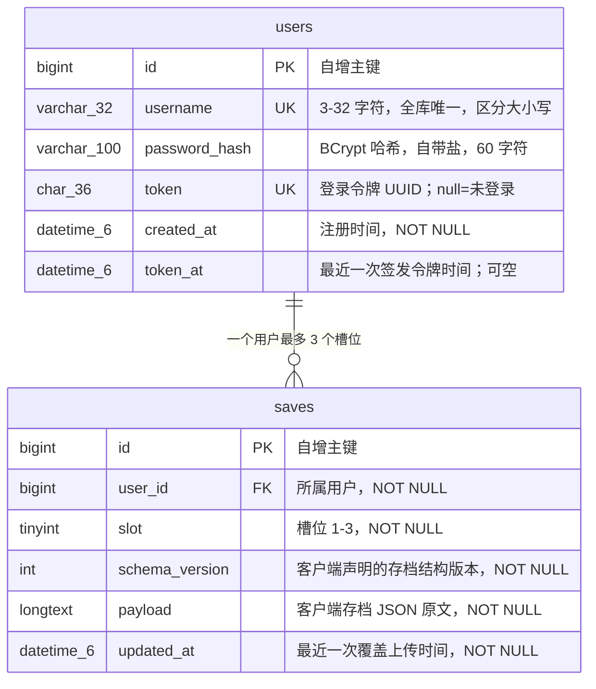

# 用户与云存档 ER（M6-02-S）

> 对应实现：`GameServer/src/main/java/com/twelvejade/server/auth/UserEntity.java`、
> `GameServer/src/main/java/com/twelvejade/server/save/SaveEntity.java`。
> MySQL 建表 DDL：`Database/SQL/V1__user_cloud_save.sql`（与实体注解一一对应）。
> 逐字段语义见 `Database/DataDictionary/用户与云存档数据字典.md`。

## 图

## 关系与约束

- `users 1 : 0..3 saves`——每个用户最多三条存档记录，`(user_id, slot)` 唯一
  （`uk_saves_user_slot`），一槽永远只有"最新一份"，上传走 INSERT-or-UPDATE 覆盖。
- `token` 全库唯一且可空：null 表示未登录；同一时刻一个账号只有一个有效令牌
  （每次登录换发并作废旧令牌）。
- 存档的真相在客户端，服务端对 `payload` **只存不读**——服务端不解释、不校验
  payload 内部结构，只做整包的版本门禁（`schema_version > 10` 拒收）。

## H2（默认 profile）与 MySQL 的类型映射差异

| 概念 | MySQL DDL（本目录脚本） | H2 自动建表（ddl-auto=update） |
|---|---|---|
| 日期时间（无时区） | `DATETIME(6)` | `TIMESTAMP` |
| 长文本 | `LONGTEXT` | `CLOB` |
| 定长 36 字符令牌 | `CHAR(36)` | `CHAR(36)`（按实体 columnDefinition） |

语义等价：UUID 恒为 36 字符，CHAR/VARCHAR 行为一致；`DATETIME(6)` 规避了 MySQL
`TIMESTAMP` 的 2038 上限与时区转换行为。差异已在本文件与数据字典中成文，不算双真相。
