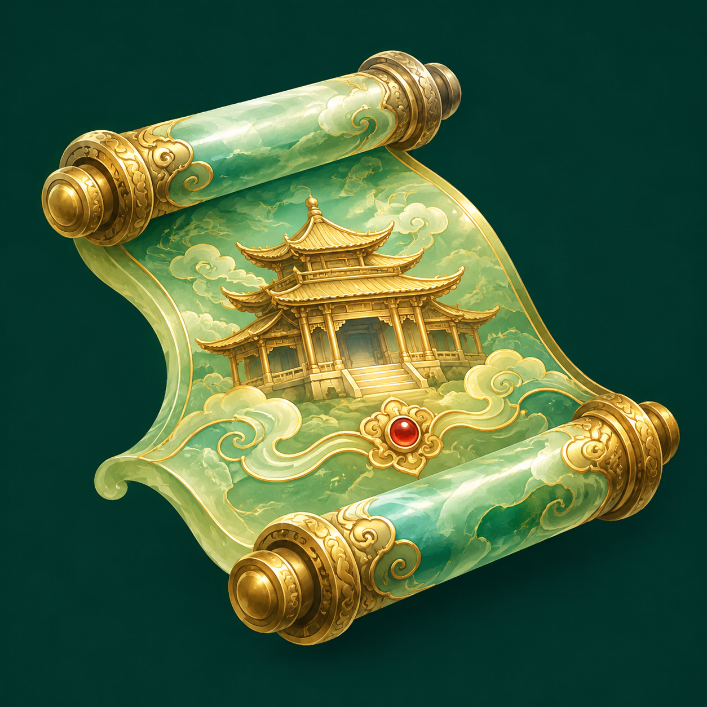

# 应用图标：玉卷仙楼 v1

制作与验证日期：2026-11-20。



## 视觉与文件

以展开的青玉经卷为主形，卷面浮雕金色仙楼与云纹，用一颗朱砂红宝珠点睛。深墨绿底与亮玉色保持对比，主体集中在中央，给手机桌面的圆形、圆角遮罩留出空间。图中不放文字，不预制圆角。

- 游戏资产：`GameClient/TwelveJade/Assets/Branding/eternal-jade-scroll-app-icon-v1.png`。
- 实际输出：1254 × 1254，RGB、不透明 PNG，2,091,373 bytes；保留原始生成尺寸，平台构建工具按目标尺寸缩放。
- SHA256：`fd882cdae9eb3ac5fd0459d0fcb6893e56f68113846a318f7af66f48297b9a59`。
- Unity GUID：`729da35b73df45dab0cc81b56e37674d`。默认 PlayerSettings 图标引用此资产。
- 导入：不生成 mipmap，保持原始非二次幂尺寸，无纹理压缩。

## 来源

根据本项目原创描述使用用户提供的 `image-studio` skill 文生图。实际成功渠道为 ChuanAPI，模型为 `gpt-image-2.5-flare`；未使用外部参考图。内置生图工具本次不可用，改用该 skill 已配置的渠道生成。服务凭据、下载响应和运行日志均不进入公开仓库。

此记录说明制作过程，不额外声明生成服务授予了何种版权或商用许可。

## 已验证与范围

- PNG 可读取，尺寸、SHA256、meta GUID 与 PlayerSettings 引用一致。
- 默认图标的序列化结构已与独立团结工程经编辑器保存后的结构核对。
- 已替换原生 HarmonyDeviceTest 的应用和启动图标，重新构建、签名、安装与启动通过；安装包资源查询确认图标引用。
- 团结独立最小工程也使用此图标，已在 API 26 真机显示；引擎渲染与点击计数测试通过。
- 正式 Unity 6 游戏未在本轮重新构建，完整鸿蒙游戏迁移尚未完成。

## 生成提示词

```text
Create one premium mobile game app icon for the original Chinese xianxia game Eternal Jade Scroll, 十二玉楼长生经. A single iconic celestial jade scroll: luminous pale celadon and emerald jade, restrained antique gold rollers, softly unfurled curved jade surface. A stylized ancient Chinese immortal pavilion is embossed in warm gold on the scroll, integrated into one strong emblem, with subtle cloud engravings and one small cinnabar-red jewel accent. Deep ink-teal / forest-green opaque full-bleed background, clean breathing room. Exquisite hand-painted jade and gold relief, elegant mineral-pigment colors, crisp confident silhouette, restrained soft highlights, polished high-end game illustration. The large luminous scroll occupies the central 68 percent of a square, recognizable at 48px. Important art stays within the central 72 percent to survive circle and rounded-square masks. Full-bleed square image, all four corners opaque. No words, no letters, no Chinese characters, no watermark, no phone mockup, no collage, no pre-rounded corners, no border or frame. Avoid faces, people, dragons, weapons, busy scenery, neon, excessive particles, plastic shine, and tiny decorative clutter. Generate finished icon artwork only, 1024x1024.
```
